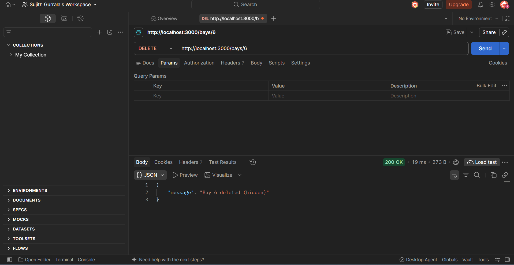
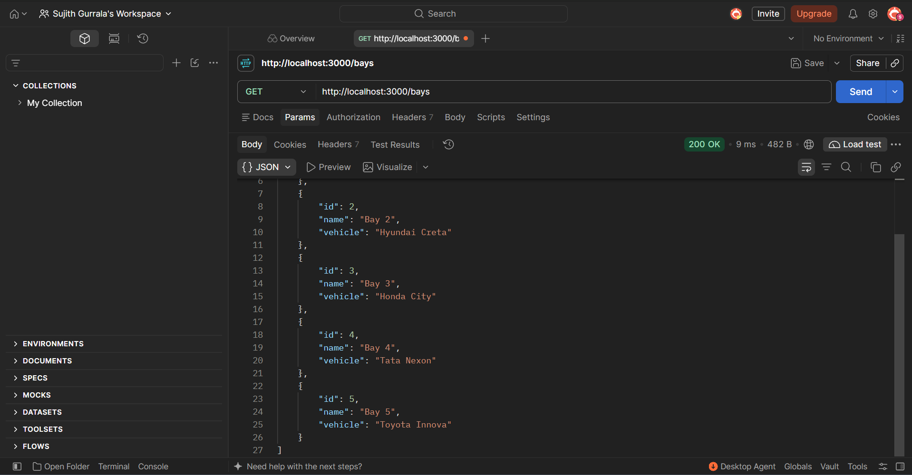
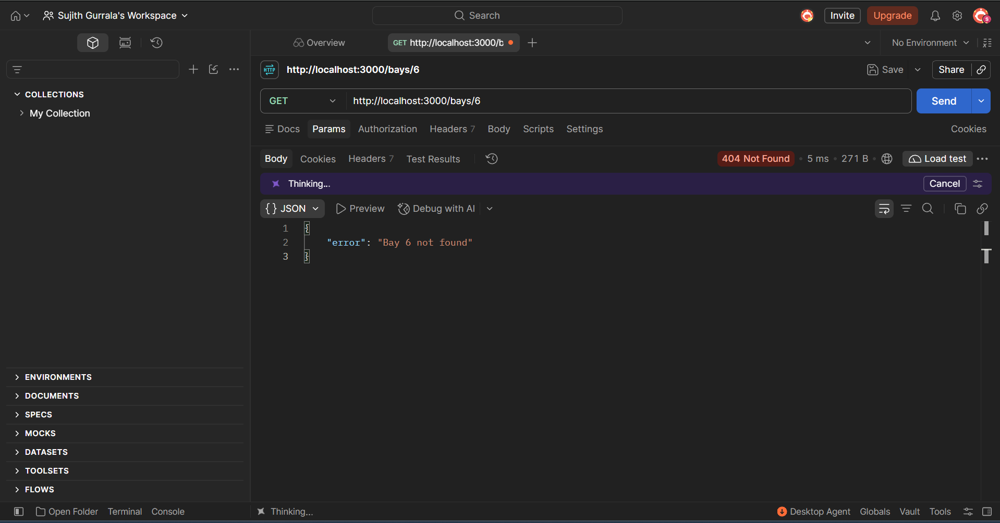
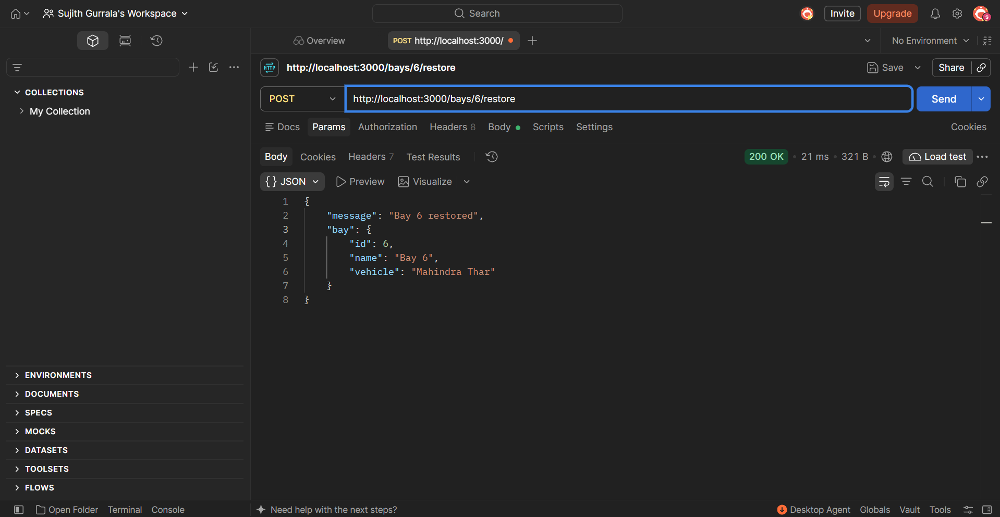
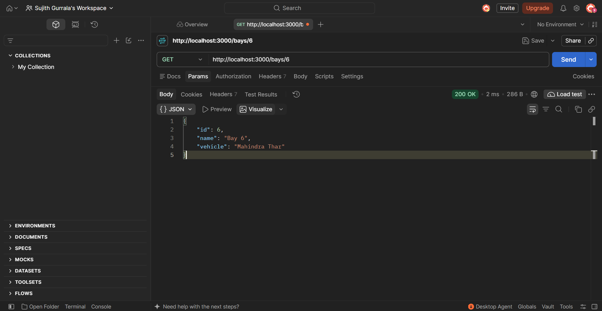
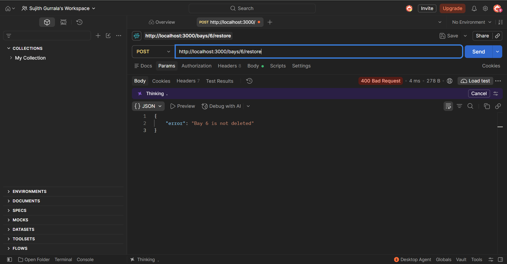
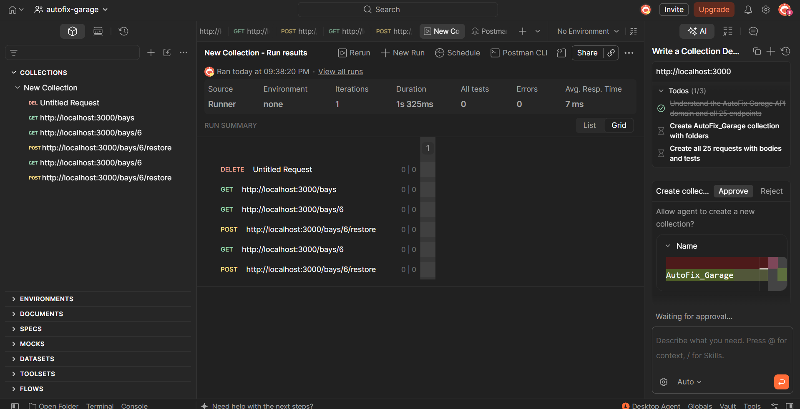

## Screenshots and Outputs

The following screenshots demonstrate the soft delete and restore functionality of the AutoFix Garage API.

### Test 1: Delete Bay 6

**Request:** `DELETE /bays/6`

**Expected Status:** 200 OK

This request performs a soft delete on Bay 6. The bay is hidden instead of being permanently removed from the database.

### Extra Test: Get All Bays

**Request:** `GET /bays`

**Expected Status:** 200 OK

The response displays all visible service bays. Bay 6 should not appear in the list because it has been deleted.

### Test 2: Get Deleted Bay

**Request:** `GET /bays/6`

**Expected Status:** 404 Not Found

The API returns a 404 error because Bay 6 is hidden after the soft delete operation.

### Test 3 (1 of 2): Restore Bay 6

**Request:** `POST /bays/6/restore`

**Expected Status:** 200 OK

This request restores Bay 6 by changing its deleted value from 1 to 0.

### Test 3 (2 of 2): Get Restored Bay

**Request:** `GET /bays/6`

**Expected Status:** 200 OK

After restoration, Bay 6 can be retrieved successfully with its original details.

### Extra Test: Restore a Bay That Is Not Deleted

**Request:** `POST /bays/6/restore`

**Expected Status:** 400 Bad Request

The API returns a 400 error because Bay 6 is already restored and is not deleted.

### Postman Collection Runner

The Postman Collection Runner is used to execute the API test cases and verify their results.

